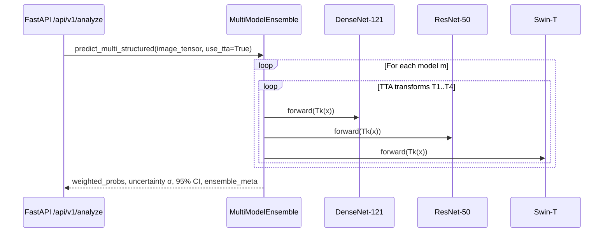
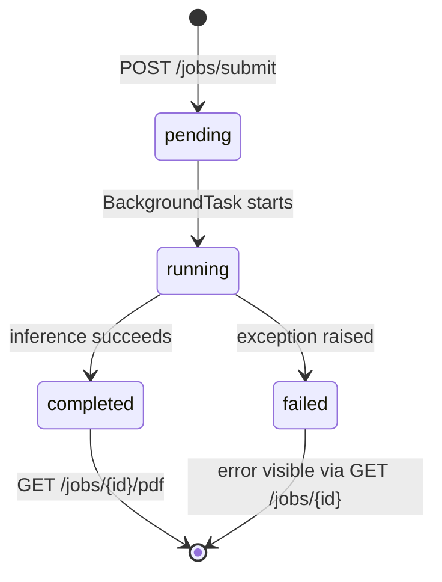

# Architecture Specification: Multi-Disease Chest X-Ray AI Service
## Version 2.2.0 — All Phases Complete

This document describes the neural network architectures, explainability mechanisms, full system design, and all upgrades implemented across Phase 1–5 of the NIH ChestX-ray14 AI microservice.

---

## 1. System Overview

The microservice comprises five fully integrated subsystems:

```mermaid
flowchart TD
    subgraph Data Layer
        A[NIH ChestX-ray14 Images / DICOM] --> D[src.data.splits: Patient Split]
        B[Data_Entry_2017_v2020.csv] --> D
        D -->|Leakage Check Asserted| E[NIHChestXrayDataset]
        DICOM[DICOM Upload .dcm] --> DL[src.dicom.loader]
        DL -->|base64 JPEG + metadata| API
    end

    subgraph Model Zoo
        E --> F[DenseNet-121 Classifier]
        E --> G[ResNet-50 Classifier]
        E --> H[Swin-T Transformer]
    end

    subgraph Phase 1 — Ensemble + TTA + Uncertainty
        F --> ENS[MultiModelEnsemble]
        G --> ENS
        H --> ENS
        ENS -->|Soft-voting| PROB[14-class probabilities]
        ENS -->|σ uncertainty| UNC[Uncertainty Quantification]
        PROB --> ONNX[ONNX Runtime Engine]
    end

    subgraph Explainable AI Layer
        F --> I[Grad-CAM / Grad-CAM++]
        G --> I
        H --> J[Reshape Transform Grad-CAM]
        I --> K[BBox Localization & Pointing Game]
        J --> K
    end

    subgraph VLM Layer Phase 4
        E --> L[src.vlm.data_builder]
        L --> M[MedGemma LoRA/QLoRA]
        L --> N[LLaVA-Med LoRA/QLoRA]
        L --> O[BiomedGPT LoRA]
        M --> P[src.eval.vlm_eval: Findings Parser]
        N --> P
        O --> P
    end

    subgraph Production Service
        ENS -.-|Ensemble Predictions| API[app.py FastAPI v2.2.0]
        I -.-|Heatmap Overlays| API
        P -.-|Validated Findings| API
        API -->|JSON| FE[React Frontend]
        API -->|PDF| PDF[ACR-style PDF Report]
        API -->|job_id| JQ[Async Job Queue]
        JQ -->|completed result| API
    end
```

---

## 2. Model Zoo Specifications

### 2.1 DenseNet-121 (`NIHDenseNet`)
- **Weights**: TorchXRayVision `densenet121-res224-all` (18 source outputs).
- **Input**: Converted to XRV grayscale scaling and resized to 224 × 224.
- **Outputs**: The 14 shared pathology scores are reordered to the service label list. `No_Finding` is derived as the complement; it is not an XRV-trained output.
- **XAI Target Layer**: XRV DenseNet `features` output.
- **Ensemble Weight**: 0.45 before normalization across loaded models.

### 2.2 ResNet-50 (`NIHResNet50`)
- **Weights**: TorchXRayVision `resnet50-res512-all` (18 source outputs).
- **Input**: Converted to XRV grayscale scaling and resized to 512 × 512.
- **Outputs**: Same 14 pathology mapping and derived `No_Finding` score as DenseNet.
- **XAI Target Layer**: XRV ResNet `layer4` output.
- **Ensemble Weight**: 0.25 before normalization across loaded models.

### 2.3 Swin Transformer Tiny (`NIHSwin`)
- **Backbone**: `swin_tiny_patch4_window7_224` via `timm`. Depths: [2, 2, 6, 2].
- **Classification Head**: Norm → Adaptive Avg Pool → `nn.Linear(768, 14)` → Sigmoid.
- **XAI**: Grad-CAM with Reshape Transform $(B, H, W, C) \to (B, C, H, W)$.
- **Ensemble Weight**: 0.30 before normalization; Swin-T is not loaded by production startup.

---

## 3. Phase 1 — Ensemble, TTA & Uncertainty

> **Current serving configuration:** `app.py` loads a two-model ensemble: TorchXRayVision DenseNet-121 (`densenet121-res224-all`) and ResNet-50 (`resnet50-res512-all`). The default raw weights 0.45 and 0.25 are normalized across those two loaded models. Swin-T remains an optional research model and is not registered by the service startup. XRV weights are fetched and cached on first initialization. Both XRV models provide 18 outputs; the service maps the 14 shared findings and derives `No_Finding` because XRV has no trained output for that label.

### 3.1 Ensemble Inference Path



### 3.2 Uncertainty Formula
$$\sigma_c = \sqrt{\frac{1}{N-1} \sum_{i=1}^N (P_{i,c} - \bar{P}_c)^2}$$
$$\text{is\_uncertain}_c = (\sigma_c \ge 0.08 \land 0.25 \le \bar{P}_c \le 0.75) \lor (\sigma_c \ge 0.15)$$

### 3.3 ONNX Export Specification
| Field | Value |
|---|---|
| Input name | `input` |
| Input shape | `(batch_size, 3, 224, 224)` |
| Output names | `logits`, `probabilities` |
| Opset | 17 |
| Optimization | `ORT_ENABLE_ALL` |
| Provider priority | `CUDAExecutionProvider → CPUExecutionProvider` |

---

## 4. Phase 2 — DICOM Ingestion, Async Jobs & PDF Reports

### 4.1 API Endpoints Added

| Method | Path | Purpose |
|---|---|---|
| `POST` | `/api/v1/dicom/upload` | Upload `.dcm` → receive base64 JPEG + DICOM metadata |
| `POST` | `/api/v1/jobs/submit` | Submit analysis job → returns `job_id` immediately |
| `GET` | `/api/v1/jobs/{job_id}` | Poll job status and retrieve result |
| `GET` | `/api/v1/jobs` | List recent jobs |
| `POST` | `/api/v1/report/pdf` | Synchronous analysis → download PDF |
| `GET` | `/api/v1/jobs/{job_id}/pdf` | Download PDF for completed job |

### 4.2 Async Job Lifecycle



### 4.3 PDF Report Structure
```
┌─────────────────────────────────────────────┐
│  NIH ChestX-ray14 AI Screening Report       │  ← dark header
│  Patient ID · Study Date · Request ID        │
├─────────────────────────────────────────────┤
│  ⚠ OVERALL IMPRESSION: ABNORMAL             │  ← impression banner
├─────────────────────────────────────────────┤
│  TECHNIQUE  (models, inference mode)         │
├─────────────────────────────────────────────┤
│  FINDINGS   (14-row table, uncertainty cells)│
├─────────────────────────────────────────────┤
│  IMPRESSION (AI narrative)                   │
├─────────────────────────────────────────────┤
│  [Grad-CAM figure]                           │
├─────────────────────────────────────────────┤
│  DISCLAIMER (mandatory research-only)        │
└─────────────────────────────────────────────┘
```

---

## 5. Phase 3 — Medical Frontend Viewport

### 5.1 XrayViewer Component
- **Controls**: Scroll zoom (0.3×–5×), click-drag pan, brightness/contrast sliders, LUT invert, Grad-CAM overlay toggle with opacity.
- **Implementation**: CSS `filter` + CSS `transform` — zero external dependencies.
- **CAM Blending**: `mix-blend-mode: screen` at configurable opacity (0.1–1.0).

### 5.2 ResultsPage Tab Architecture

```
ResultsPage
├── [Overview tab]
│   ├── MultiDiseaseResults (sortable, uncertainty badges, CI bars)
│   ├── HeatmapGallery (per-disease Grad-CAM)
│   └── ReportEditor (human-in-the-loop review)
├── [Image Viewer tab]
│   └── XrayViewer (zoom, pan, W/L, Grad-CAM overlay)
└── [Comparison tab]
    └── LongitudinalComparison (prior vs current, delta table)
```

### 5.3 Longitudinal Comparison Data Flow
```
Session A (prior scan)  ─── sessionStorage.setItem('priorResult') ───┐
Session B (new scan)    ─── GET sessionStorage('priorResult')    ───→ LongitudinalComparison
                                                                        ├── Side-by-side images
                                                                        ├── Delta table (▲▼↔)
                                                                        └── NEW / RESOLVED badges
```

---

## 6. Phase 4 — VLM Fine-Tuning & Evaluation

### 6.1 VLM Registry

| VLM | Model ID | LoRA Targets | VRAM (4-bit) | VRAM (16-bit) | Gated |
|---|---|---|---|---|---|
| `medgemma` | `google/medgemma-4b` | q/k/v/o/gate/up/down proj | ~8 GB | ~16 GB | ✓ HF token |
| `llava_med` | `microsoft/llava-med-v1.5-mistral-7b` | q/k/v/o proj | ~10 GB | ~20 GB | ✗ |
| `biomedgpt` | `microsoft/BiomedNLP-BiomedBERT-base-uncased-abstract-fulltext` | query/key/value | ~4 GB | ~8 GB | ✗ |

### 6.2 Instruction Task Distribution

| Task Type | Prompt | Response |
|---|---|---|
| `findings_list` | "List all thoracic abnormalities" | "Identified findings: Atelectasis, Effusion." |
| `yes_no_query` | "Does this CXR show Atelectasis?" | "Yes, findings consistent with Atelectasis are present." |
| `structured_summary` | "Systematic 14-disease checklist" | "- Atelectasis: Positive\n- Cardiomegaly: Negative…" |

### 6.3 Findings Parser Strategy (3-cascade)
1. Direct NIH class name search (with explicit-negative exclusion from checklist).
2. `"- Disease: Positive"` pattern match.
3. `"Identified findings: X, Y"` prefix extraction.

---

## 7. Explainability & Localization

| Property | Standard Grad-CAM | Grad-CAM++ | Swin Reshape CAM |
|---|---|---|---|
| **Weighting** | $\frac{1}{Z}\sum \frac{\partial Y^c}{\partial A^k}$ | Higher-order positive derivatives | Gradient backprop post-permute |
| **Multi-Focal** | Moderate | High | High |
| **Output** | $7\times7 \to 224\times224$ (bilinear) | $7\times7 \to 224\times224$ | $7\times7 \to 224\times224$ |
| **Evaluation** | Pointing Game Accuracy & BBox IoU vs `BBox_List_2017.csv` |

---

## 8. Training Pipeline

### 8.1 CNN Retraining Orchestration
```bash
python scripts/retrain_all.py \
    --csv_path /data/Data_Entry_2017_v2020.csv \
    --image_dir /data/images/ \
    --output_dir outputs/retrained/ \
    [--models densenet121 resnet50 swin_tiny] \
    [--dry-run]
```

### 8.2 Trainer Features (`src.train.trainer.MultiLabelTrainer`)
- AMP mixed precision (`torch.cuda.amp.GradScaler`)
- `channels_last` memory format (CUDA)
- Linear warmup → cosine annealing LR schedule
- Gradient clipping (`max_norm=1.0`)
- Macro-AUROC early stopping
- `best_model.pth` + `last_model.pth` checkpointing
- Per-class threshold calibration via grid search on validation set

### 8.3 Checkpoint Safety Policy
| Directory | Action |
|---|---|
| `test_nih/saved_models/` | Optional research checkpoints; not used by production inference |
| `outputs/retrained/{model}/` | Written by retraining jobs only |
| `outputs/onnx/` | Written by ONNX export jobs only |
| `outputs/vlm/{model}_lora/` | Written by VLM fine-tuning jobs only |

---

## 9. Complete API Reference (v2.2.0)

| Method | Path | Tags | Description |
|---|---|---|---|
| `GET` | `/health` | monitoring | Service health check |
| `GET` | `/api/v1/health` | monitoring | Same, versioned |
| `GET` | `/api/v1/model/info` | monitoring | Model details |
| `POST` | `/api/v1/analyze` | inference | Sync analysis (JSON) |
| `POST` | `/api/v1/dicom/upload` | dicom | DICOM → base64 JPEG |
| `POST` | `/api/v1/jobs/submit` | async-jobs | Submit background job |
| `GET` | `/api/v1/jobs/{job_id}` | async-jobs | Poll job status |
| `GET` | `/api/v1/jobs` | async-jobs | List recent jobs |
| `POST` | `/api/v1/report/pdf` | report | Sync PDF download |
| `GET` | `/api/v1/jobs/{job_id}/pdf` | report,async-jobs | PDF from completed job |
| `POST` | `/api/v1/report/validate` | report | Hallucination check |
| `POST` | `/predict` | inference | Legacy single-prediction (backward compat) |
